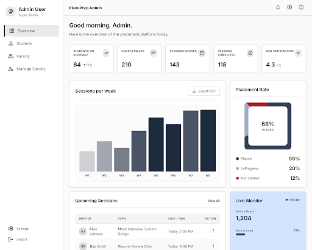
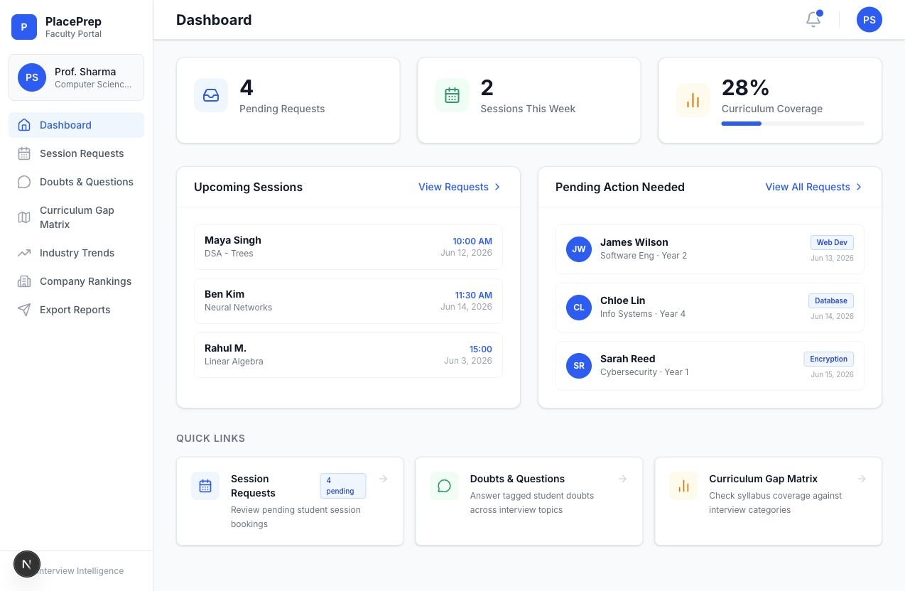

# PlacePrep

A placement preparation platform for NST students — company-specific interview intelligence, personalized prep roadmaps, faculty doubt resolution, and admin-facing analytics, delivered as three independently deployed portals over a shared MongoDB-backed service layer.

---

## Overview

Most students preparing for tech placements piece together a plan from scattered LeetCode lists, YouTube playlists, and senior-year advice — with no visibility into what a specific company actually asks, and no structured way to track progress toward it. Faculty, meanwhile, have no efficient way to see who's actually preparing or to triage the flood of ad-hoc doubts they get over chat.

PlacePrep addresses both sides: students get a company-specific prep roadmap built from a real question bank of 20,000+ interview questions across 678 companies, and faculty/admins get a dashboard to track engagement, resolve doubts, and manage sessions — all backed by one shared database instead of three disconnected tools.

---

## Portals

| Portal | Description | Live Link |
|--------|-------------|-----------|
| 🧑‍🎓 **Student Portal** | Browse companies, practice company-wise questions, track prep roadmap, book faculty sessions | [placeprep-student.vercel.app](https://placeprep-student.vercel.app) |
| 👨‍🏫 **Faculty Portal** | Curriculum intelligence dashboard, respond to student doubts | [placeprep-faculty.vercel.app](https://placeprep-faculty.vercel.app) |
| 👨‍💼 **Admin Portal** | Platform overview, student/faculty management, analytics | [placeprep-admin.vercel.app](https://placeprep-admin.vercel.app) |

All three portals share one login. Sign in at the **Student Portal** link above — faculty and admin accounts are automatically redirected to their respective portal after authentication.

---

## Screenshots

| Admin — Platform Overview | Faculty — Dashboard |
|---|---|
|  |  |

---

## Key Features

**Student Portal**
- 4-step onboarding — target domains, target company tiers, self-rated topic confidence, prep timeline
- Company intelligence pages — round structure, topic frequency, difficulty distribution, and a full question bank per company
- Roadmap engine — up to 5 target companies, each generating a week-by-week prep plan with XP rewards and progressively unlocked weeks
- Practice zone — question bank filterable by topic, difficulty, round type, and company
- Dashboard — readiness gauges, daily tasks, streaks, XP, and an activity heatmap
- Doubt system — post doubts tagged by topic; faculty respond directly
- Session booking — calendar-based booking with faculty, confirmed sessions get a video-call link
- Interview experience submission — students share and upvote real interview write-ups
- Leaderboard, profile, notifications, global search across companies/questions/topics

**Faculty Portal**
- Dashboard home — KPI overview and live insights feed
- Curriculum gap matrix — heatmap of syllabus coverage vs. industry demand
- Session requests — confirm or reschedule student mock-interview bookings
- Doubt resolution — respond to student doubts, organized by topic
- Industry trends, company rankings, exportable reports

**Admin Portal**
- Platform-wide overview — student/faculty counts, engagement metrics, DAU/MAU
- Student and faculty account management
- Analytics — engagement heatmaps, doubt intelligence, practice-zone stats, placement tracking
- Leaderboard management, session bookings, notifications, exportable reports

---

## Tech Stack

| Layer | Technology |
|---|---|
| Frontend | Next.js 15/16 (App Router), React, TypeScript, Tailwind CSS |
| Backend | Node.js + TypeScript service layer (models / repositories / services / validators), consumed via Next.js API routes |
| Database | MongoDB Atlas via Mongoose |
| Auth | JWT + per-portal cookie-based middleware |
| Validation | Zod |
| Logging | Pino |
| Charts | Recharts, Chart.js |
| Deployment | Vercel — three independent projects from one monorepo |

---

## Architecture

```
placeprep/
├── backend/src/          # Shared service layer — models, repositories, services, validators
│   ├── models/           # Mongoose schemas (User, Company, Question, SessionBooking, ...)
│   ├── repositories/     # Data-access layer
│   ├── services/         # Business logic (auth, faculty, student, doubts, sessions, ...)
│   └── validators/       # Zod request schemas
├── dashboard/
│   ├── student-portal/   # Next.js app — companies, roadmap, practice, doubts, sessions
│   ├── faculty-portal/   # Next.js app — curriculum gap analysis, doubt resolution
│   └── admin-portal/     # Next.js app — platform overview, user management, analytics
├── companies.json        # Seed dataset — 678 companies
├── questions.json        # Seed dataset — 20,372 interview questions
└── DATA_SOURCES.md       # Where the seed dataset comes from
```

Each portal is its own Next.js app with its own `package.json`, deployed as its own Vercel project, importing shared backend logic from `backend/src`. There's no separate API server — the backend service layer runs inside each portal's own Next.js API routes.

---

## Data

Seeded from a MongoDB Atlas cluster with 678 companies and 20,372 interview questions, imported via `backend/src/scripts/import-json.ts`. See [DATA_SOURCES.md](./DATA_SOURCES.md) for exactly where that dataset comes from — it's sourced from two public, well-known company-wise interview-question compilations rather than an in-house scraper, and that's documented rather than glossed over.

---

## Getting Started

```bash
git clone https://github.com/InfinityAditya07/Personal_Project_Placeprep_Aditya_Raj_Sharma.git
cd Personal_Project_Placeprep_Aditya_Raj_Sharma
npm install

# Copy .env.example to backend/.env (and the relevant NEXT_PUBLIC_* vars into each
# portal's .env.local) and fill in your own values — nothing here ships with real secrets.

npm run dev   # starts all three portals concurrently (student :3000, faculty :3001, admin :3002)
```

---

## Deployment

**Vercel** — all three portals deploy independently from this monorepo:
- Student: https://placeprep-student.vercel.app
- Faculty: https://placeprep-faculty.vercel.app
- Admin: https://placeprep-admin.vercel.app

---

## Roadmap

**Shipped**
- Company listing and question bank, live from MongoDB
- Consistent theme across all three portals
- Core student flows: onboarding, roadmap, practice, doubts

**In progress**
- Full backend API wiring (student portal is furthest along; faculty/admin still have some mock-data views)
- Session bookings end-to-end
- Authentication hardening across all three portals

**Planned**
- Automated test coverage for the backend service layer
- CI (lint + typecheck) on push

---

## License

MIT for the application code — see [LICENSE](./LICENSE). The bundled interview-question dataset has its own provenance and isn't covered by the same terms — see [DATA_SOURCES.md](./DATA_SOURCES.md).

---

## Contact

**Aditya Raj Sharma**
GitHub: [InfinityAditya07](https://github.com/InfinityAditya07)
